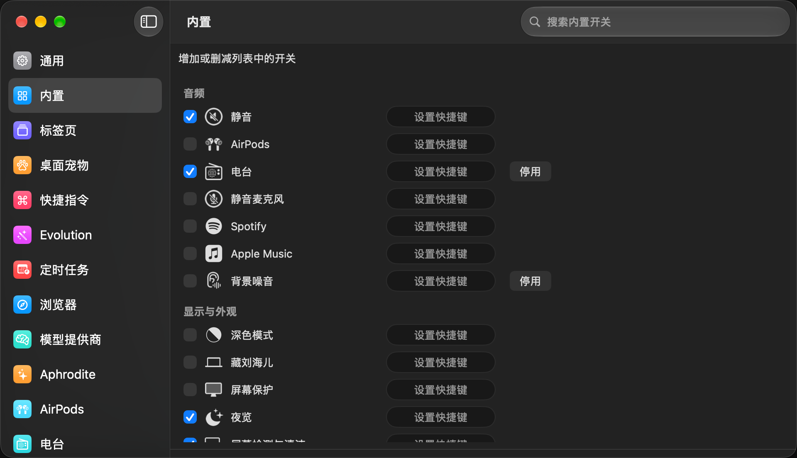

# 内置设置中停用背景噪音影响电台且状态未及时刷新

- 记录日期：2026-11-27
- 状态：代码已修复，待实际播放和媒体键验证
- 位置：设置 → 内置 → 音频
- 环境：macOS；OnlySwitch 和 macOS 版本待补充

## 问题描述

用户反馈，在“内置”设置页面停用背景噪音时，电台也会被停用；页面上的状态没有及时刷新，需要切换到其他设置页面后再切回来才能看到更新。

## 复现步骤

1. 打开 OnlySwitch 的“设置 → 内置”，找到音频分类中的“电台”和“背景噪音”。
2. 点击“背景噪音”行的“停用”。
3. 观察电台的状态以及当前页面的显示；切换到其他设置页面，再切回“内置”对比状态。

## 实际结果

根据用户反馈，停用背景噪音同时停用了电台，当前页面状态没有立即刷新，切换页面后才更新。

## 预期结果

停用背景噪音不应影响电台；操作后相关状态应立即在当前页面更新，无需切换页面。

## 截图

## 排查线索

初步代码检查发现，内置设置中电台和背景噪音的停用按钮均使用 `radioEnable`，背景噪音的可见性也读取该值；这可能与联动现象有关。刷新问题的原因尚未确认，以上现象尚未独立复现。
